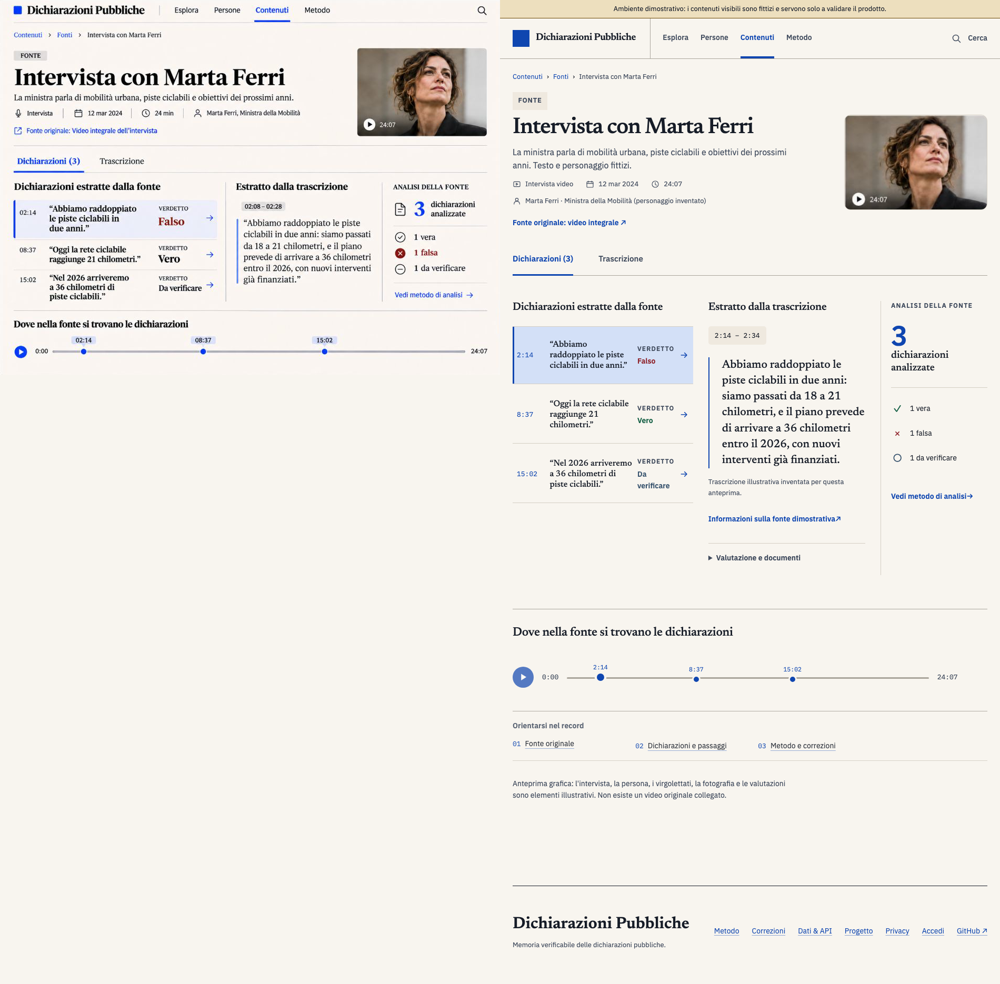

# DP #349 — source-first visual review, 11 November 2026

This is a **visual candidate**, awaiting the owner's aesthetic decision. The example called
“Intervista con Marta Ferri” is entirely fictional and is only emitted by a build with
`DICHIARAZIONI_PUBBLICHE_ALLOW_DEMO_PROJECTION=1`. It is never a published
statement, an approved source, or a claim about any actual person.

## Reference comparison



The left side is a crop of the supplied reference screenshot. The right side is a
**real Chrome capture** at a 950px CSS viewport, before final owner review.
The screenshot demonstrates the same editorial architecture: warm paper, serif
type, blue accent, divided header, source media, three-column claim/excerpt/analysis
reading workspace and timed markers. The preview intentionally includes an
explicit demo warning, a disclosure for the fictional media and a preservation
of the original public data safety boundaries. It is not a pixel-copy of the
reference, especially in vertical density and below the fold.

### Screenshots from Chrome

| Route | Viewport | Screenshot |
| --- | ---: | --- |
| Fictional source preview | 390px | [Phone](screenshots/fonte-390.png) |
| Fictional source preview | 768px | [Tablet](screenshots/fonte-768.png) |
| Fictional source preview | 950px | [Reference-aligned](screenshots/fonte-950.png) |
| Fictional source preview | 1280px | [Laptop](screenshots/fonte-1280.png) |
| Fictional source preview | 1440px | [Desktop](screenshots/fonte-1440.png) |
| Homepage | 390px and 1440px | [Phone](screenshots/home-390.png) · [Desktop](screenshots/home-1440.png) |
| Explore | 768px | [Tablet](screenshots/esplora-768.png) |
| Person | 1280px | [Desktop](screenshots/persona-1280.png) |
| Statement | 1280px | [Desktop](screenshots/dichiarazione-1280.png) |

All captures are from Chrome with a local static build, at device-scale factor 1.
Viewport measurements, captured documents and the interaction receipts
are from the browser itself. The source page has no document overflow at 390,
768, 950, 1280 and 1440 CSS pixels.

### Interaction acceptance

- Selecting a claim or timeline marker updates the selected claim styling,
  the active excerpt and the selected marker; the URL retains the chosen
  `?momento=` ID for a shareable, restorable selection.
- The tablist exposes `aria-selected`, `aria-controls`, keyboard arrow
  navigation and Home/End. Transcript pane visibility follows the tab.
  Excerpt changes announce themselves to assistive technology.
- Animated selection and scroll respect `prefers-reduced-motion`.
- Media controls only navigate to a real public media URL when that URL
  has been approved. The demo links to an explanatory note and does not
  simulate video playback. Real content without an approved transcript
  explicitly reports that limitation; normalized claims are not presented as
  verbatim quotations.

### Build and rollout boundaries

To regenerate the fictional review locally:

```sh
cd web
DICHIARAZIONI_PUBBLICHE_ALLOW_DEMO_PROJECTION=1 npm run build
npm run check:routes
npm run check:design
npm run check:design:a11y
```

To check the real publication boundary and browser behavior:

```sh
cd web
npm run check:projection-boundary
npm run check:browser:isolated
```

The production-boundary check constructs a separate, approved-empty
public-v2 projection and asserts that it contains exactly the six authorized
informational routes, that `/anteprima/fonte/` is absent, that no demo
records appear in the public index/sitemap, and that no demo records
become public merely through renaming a fixture file.

Deployment remains governed by
[DP-481 immutable release and rollback](../../ops/dp481-minipc-immutable-release.md),
with the existing candidate/review/compare-and-swap/HTTP readback procedure.
The owner must inspect the **isolated design preview** before aesthetic acceptance.
This review changes no authority for the authentic Statement/Content release
tracked separately in #413, #468 and #98.
